<p align="center">
  
</p>

<h1 align="center">PULSE — Smart Gym Performance Monitoring System</h1>

<p align="center">
  <strong>Android Performance Tracking &amp; BLE Telemetry Platform for Strength Training</strong><br/>
  Kotlin • Jetpack Compose • Navigation 3 • Room • DataStore • Android BLE GATT
</p>

---

## 1. Project Overview

**PULSE** is a modular Android smart-gym application designed to bridge traditional strength-training logging with ESP32-based IMU and distance-sensor telemetry. Athletes can plan workouts, execute sets manually or with compatible Bluetooth Low Energy (BLE) sensor telemetry, track repetition quality (full vs. partial), range of motion, tempo, and peak acceleration, and analyze training progress over time.

> **Hardware Validation Notice:** All Android application features, Room persistence, analytics, BLE GATT transport, binary packet decoding, and raw-telemetry integration tests are implemented and verified. **Physical ESP32 + sensor validation (Gate C) remains pending** until finalized firmware UUIDs, calibration offsets, and physical hardware are connected.

---

## 2. Problem Statement & Proposed Solution

### Problem
Conventional gym apps count only sets, reps, and weight—offering no objective visibility into repetition quality, range of motion (ROM), concentric/eccentric tempo, or bar/limb acceleration. Meanwhile, many hardware-companion apps fail completely when Bluetooth hardware is unavailable or disconnected.

### Proposed Solution
PULSE provides a **dual-mode, offline-first architecture**:
1. **Manual-First Reliability**: Complete workout planning, 3 evidence-informed starter plans, live set execution, direct decimal weight entry, rest timers, Room persistence, and historical analytics work 100% independently without hardware.
2. **Modular BLE Telemetry Pipeline**: A dedicated `BleTransport` + `BlePacketDecoder` + `DeviceEventNormalizer` pipeline processes real BLE notifications (or deterministic raw-byte test fixtures) with CRC-8 integrity, sequence deduplication, ATT MTU negotiation, exercise capability gating, and strict separation between genuine `SENSOR_TELEMETRY` and `SIMULATED_TELEMETRY`.

---

## 3. Main Application Features

- **Onboarding & Local Authentication**: 3-page onboarding, local salted SHA-256 registration/login, guest mode, profile setup, and strict per-owner data isolation.
- **Home & Starter Workouts**: Greeting, weekly training progress, active session restoration, and 3 transactionally seeded starter plans (*Beginner Full Body*, *Upper Body Strength*, *Lower Body Foundation*).
- **Workout Planning & 18-Exercise Library**: Searchable/filterable exercise catalog with dedicated equipment-accurate photography, exercise setup/execution guides, custom plan builder, reordering, and per-set targets.
- **Redesigned Set Execution**: Unified repetition & weight card, direct decimal weight bottom sheet (`kg`/`lbs`, `0–500 kg` / `0–1100 lbs`), live workout & set elapsed timers, rest timer, connection-loss recovery, and integrated **Live Performance** per-repetition trend chart.
- **History, Session Details & Training Progress**: Repetition-weighted ROM, rep duration, peak acceleration, full/partial breakdown, weekly volume, personal records, and simulator-isolated analytics.
- **Device Center & Developer Diagnostics**: Reactive Bluetooth status, simulated demo mode (explicitly labeled), real BLE GATT transport, and debuggable-only **Hardware Diagnostics Mode** with raw hex inspection and clipboard export.

---

## 4. Smart Device & Sensor Integration

| Layer | Implementation Status | Notes |
| --- | --- | --- |
| **Android BLE Transport** (`AndroidBleTransport`) | Implemented | Runtime permission checks, `BluetoothLeScanner`, `TRANSPORT_LE` GATT, `requestMtu(64)` with 23-byte fallback, service/CCCD `0x2902` discovery, stale-callback guards |
| **Binary Packet Decoder** (`BlePacketDecoder`) | Implemented & Unit Tested | Proposed v1 little-endian framing (`0x01` Rep Summary 20B/22B, `0x02` IMU+Distance Sample 19B/22B, `0x03` Battery 8B), CRC-8 (`0x07`), `0xFFFF` unavailable sentinel |
| **Protocol & Calibration** (`BleProtocolConfig`) | Configurable (`false` by default) | `isProtocolConfirmed = false` and `isSensorCalibrated = false` until ESP32 firmware sign-off |
| **Simulated Demo Provider** (`FakeDeviceDataSource`) | Implemented & Labeled | Explicitly tagged `SIMULATED_TELEMETRY` / `Connected (Sim)` and excluded from genuine analytics |
| **Physical ESP32 + Sensors** | **Pending (Gate C)** | Requires physical ESP32 firmware, finalized UUIDs, and live BLE testing |

See [docs/HARDWARE_INTEGRATION_CONTRACT.md](docs/HARDWARE_INTEGRATION_CONTRACT.md) and [docs/PHYSICAL_HARDWARE_TESTING_GUIDE.md](docs/PHYSICAL_HARDWARE_TESTING_GUIDE.md) for full protocol and 14-stage hardware bring-up details.

---

## 5. Technology Stack

- **Language & UI**: Kotlin `2.2.10`, Jetpack Compose (BOM `2025.09.00`), Material 3, custom `core:designsystem` tokens & components
- **Navigation**: AndroidX Navigation 3 (`1.2.2`) with Kotlinx Serialization (`1.9.0`)
- **Persistence**: Room (`2.8.5`, schema v5 with `MIGRATION_1_2`..`MIGRATION_4_5`), Jetpack DataStore Preferences (`1.3.0`)
- **Concurrency**: Kotlin Coroutines & Flow (`1.10.2`)
- **Connectivity**: Android BLE (`BluetoothLeScanner`, `BluetoothGatt`, `BluetoothGattCallback`)
- **Compatibility & Release**: `minSdk = 24`, `targetSdk = 36`, `compileSdk = 37`, `desugar_jdk_libs:2.1.5`, R8 minification & resource shrinking

---

## 6. System Architecture & Data Flow

### System Architecture

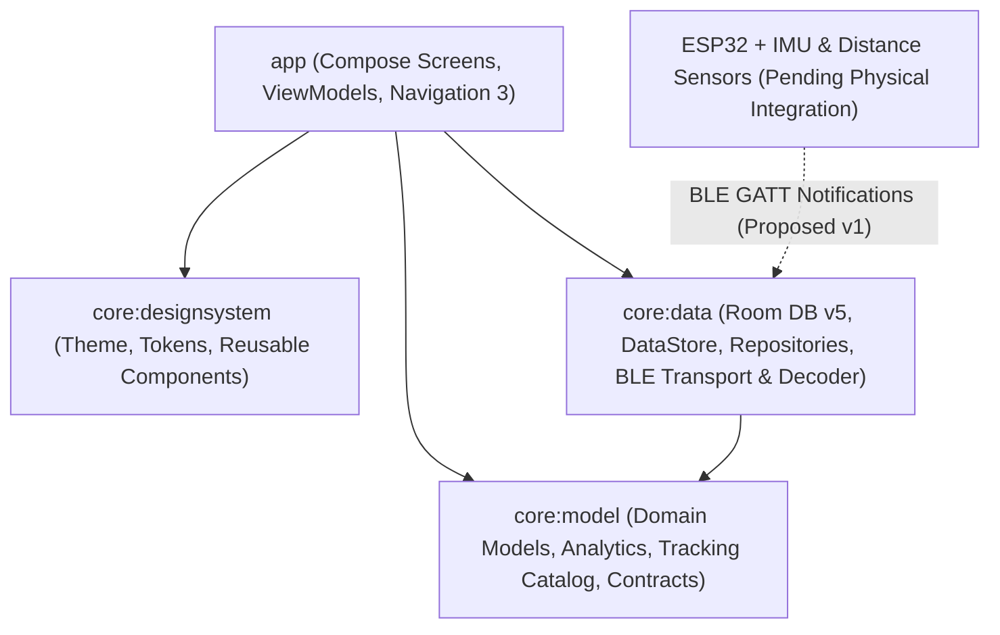

### Hardware-to-Android Data Flow

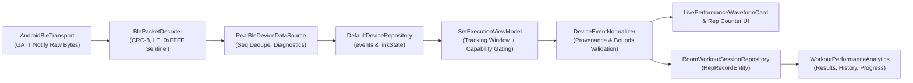

---

## 7. Android Module Structure

| Module | Responsibility |
| --- | --- |
| `app` | Navigation 3 app shell, feature screens & ViewModels (Auth, Home, Workouts, Session, Execution, Results, History, Progress, Profile, Device, Diagnostics), instrumentation tests |
| `core:model` | Pure-Kotlin domain models, repository interfaces, `ExerciseTrackingCatalog`, `WorkoutPerformanceAnalytics`, `HardwareDiagnosticsSnapshot` |
| `core:data` | Room database (`PulseDatabase` v5 + exported schemas `1.json`–`5.json`), DAOs, DataStore preferences, repositories, `AndroidBleTransport`, `BlePacketDecoder`, `RealBleDeviceDataSource`, `FakeDeviceDataSource` |
| `core:designsystem` | PULSE typography, color tokens, buttons, cards, gauges, modals, and vector icons |

---

## 8. Measurement Capabilities

| Metric | Unit | Source / Provenance | Support & Validation |
| --- | --- | --- | --- |
| **Repetitions (Full / Partial)** | count | Manual input or `SENSOR_TELEMETRY` / `SIMULATED_TELEMETRY` | 999 manual cap; 100-rep detailed ledger per set |
| **Linear Range of Motion** | `cm` | Distance sensor / ToF (`0x01` packet) | Exercise-gated (`LINEAR` / `COMPOUND`); `0xFFFF` = unavailable |
| **Angular Range of Motion** | `°` | IMU gyroscope/orientation (`0x01` packet) | Exercise-gated (`ANGULAR` / `COMPOUND`); `0xFFFF` = unavailable |
| **Repetition / Concentric / Eccentric Duration** | `ms` / `s` | Firmware rep segmentation (`0x01` packet) | Never inferred from manual button taps |
| **Peak Acceleration** | `m/s²` | IMU accelerometer (`0x01` packet) | Validated finite & non-negative; persisted in Room v4+ |

---

## 9. Application Screenshots

> All screenshots below were captured directly from the Android application running on `Medium_Phone_API_36.0` (`emulator-5554`). Simulated hardware screens are explicitly labeled (`Connected (Sim)` / `Demo Mode`).

### Onboarding & Authentication

| Welcome | Onboarding | Log In | Sign Up |
| :---: | :---: | :---: | :---: |
| 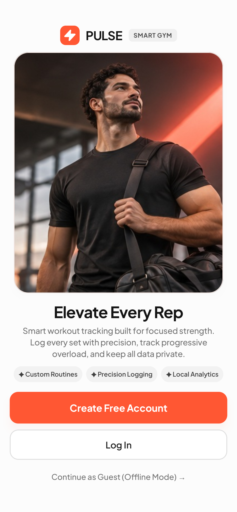 | 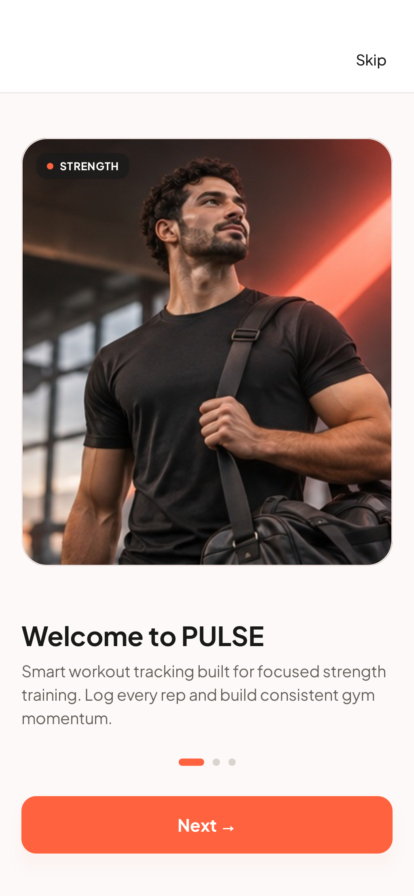 | 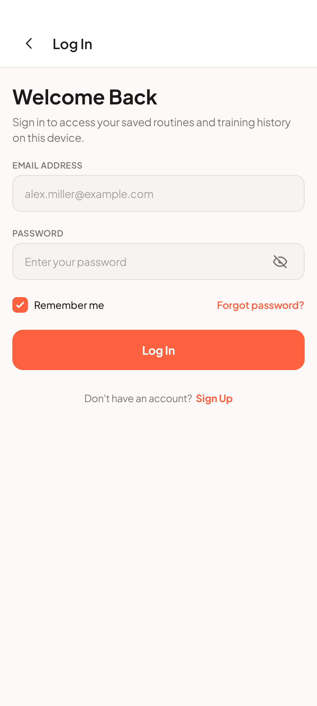 | 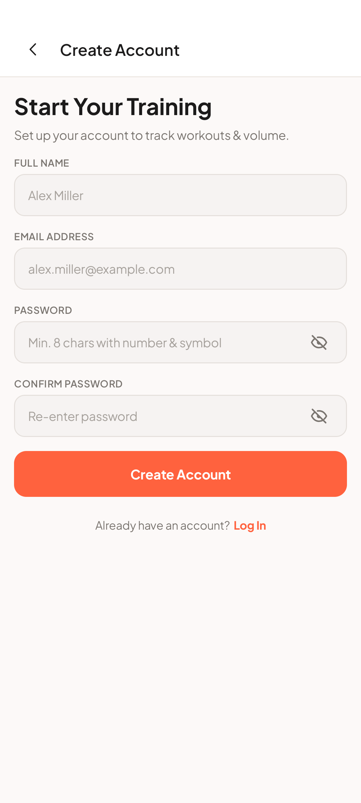 |

### Home & Workout Planning

| Home Dashboard | My Workouts (3 Starters) | Create Workout Plan | Exercise Library | Exercise Details |
| :---: | :---: | :---: | :---: | :---: |
| 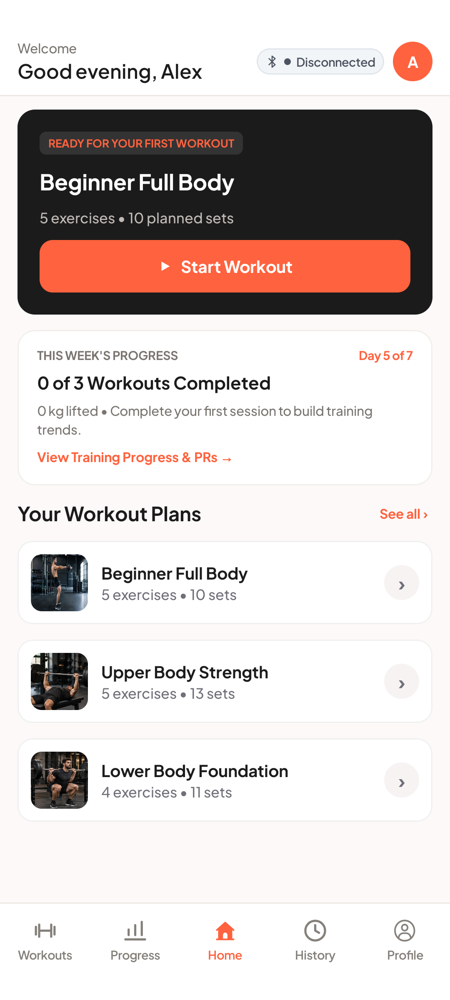 | 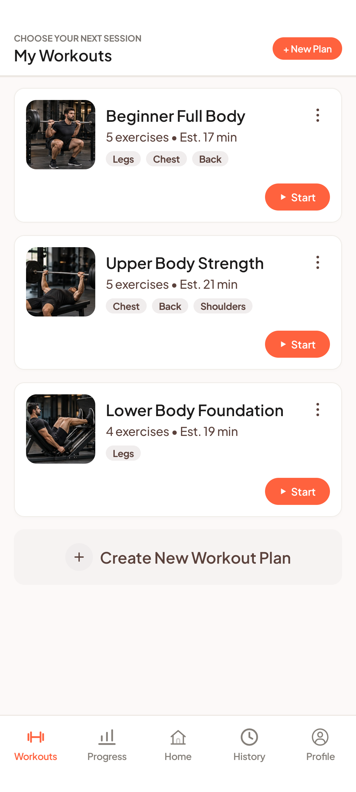 | 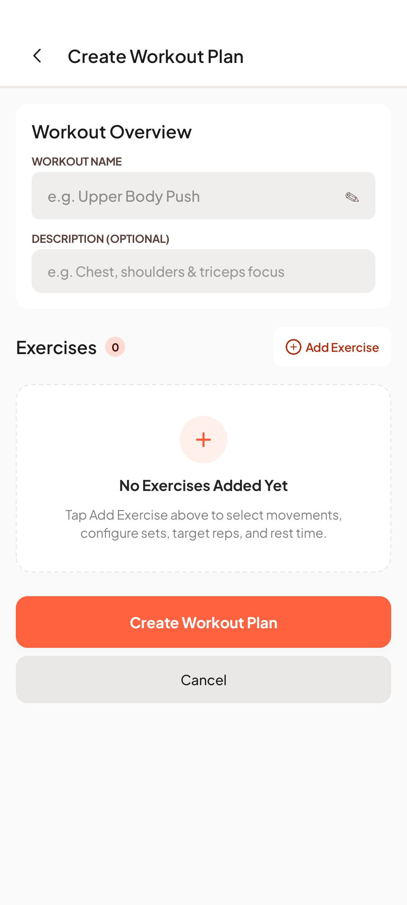 | 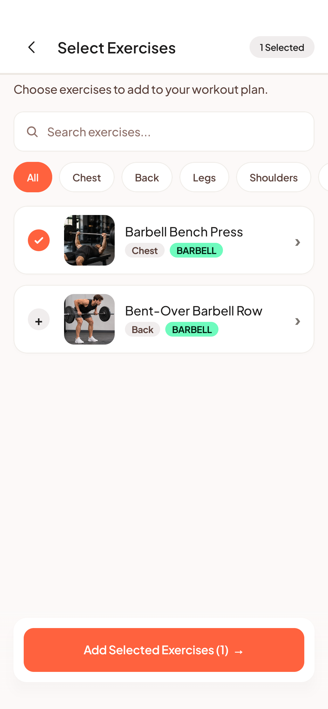 | 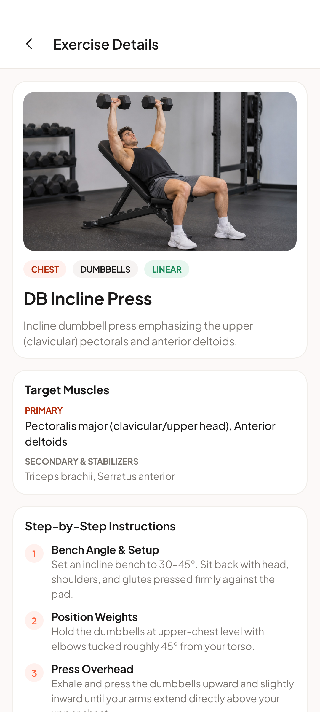 |

### Live Workout & Set Execution

| Workout Session | Set Execution — Ready | Set Execution — In Progress (`Sim` Telemetry) | Direct Weight Input | Rest Timer |
| :---: | :---: | :---: | :---: | :---: |
| 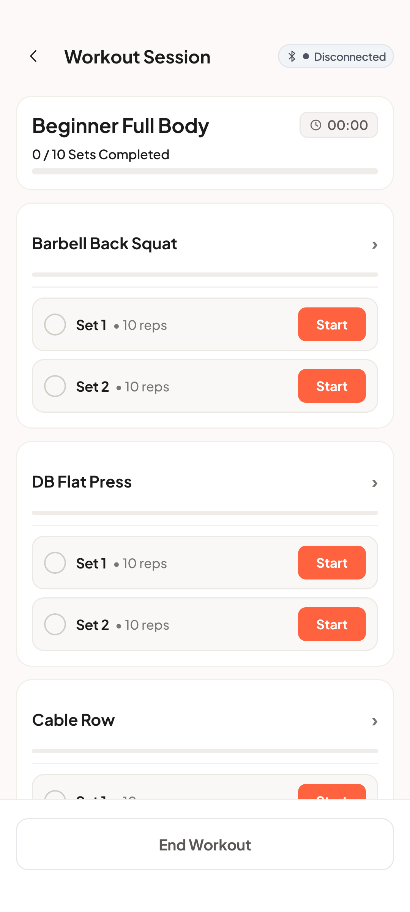 | 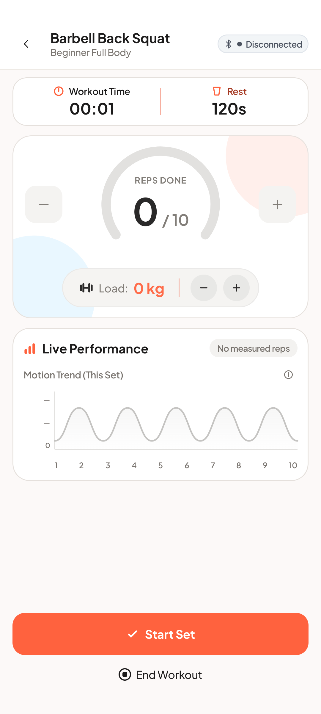 | 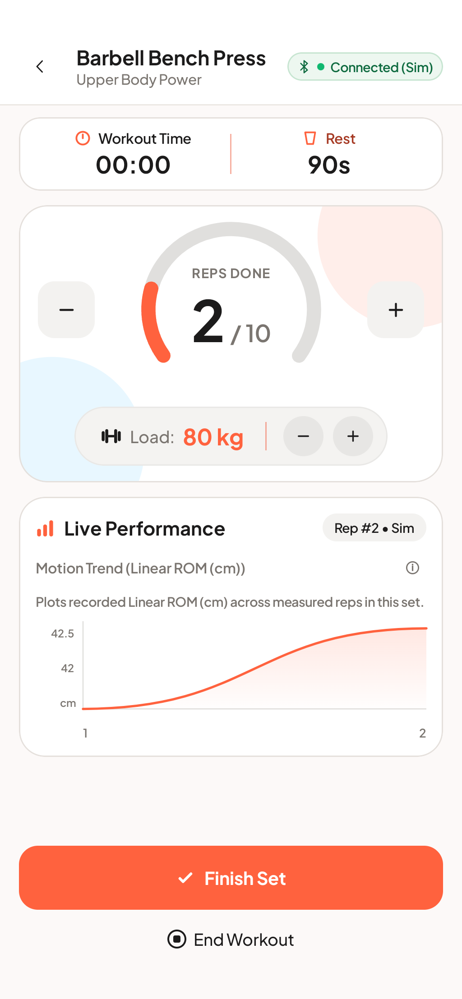 | 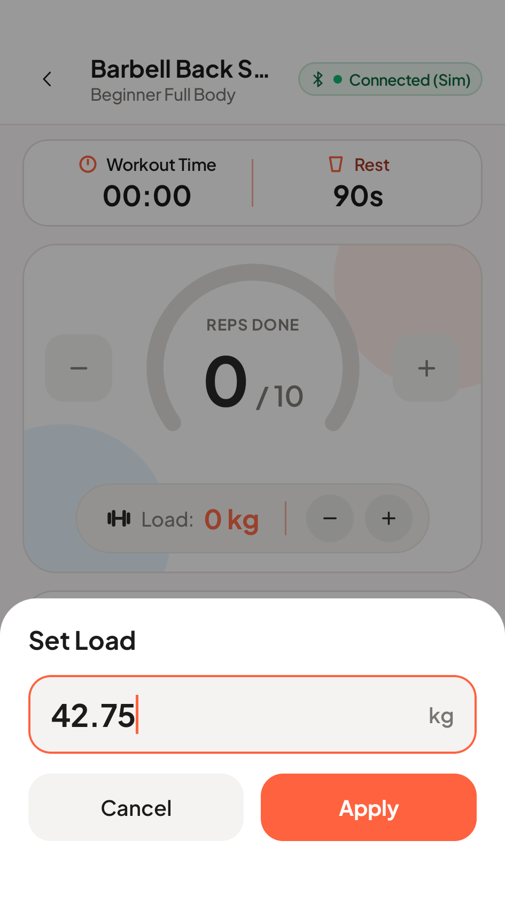 | 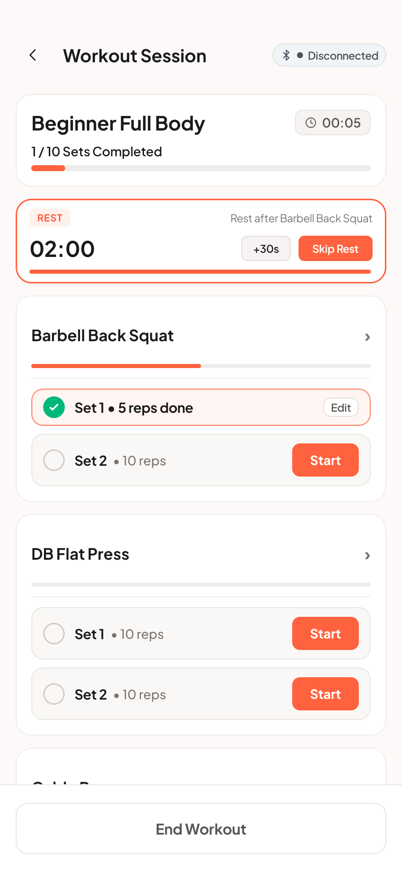 |

### Results, Analytics, Device & Profile

| Workout Results | History | Session Details | Training Progress | Device Connection (`Sim`) | Profile & Settings |
| :---: | :---: | :---: | :---: | :---: | :---: |
| 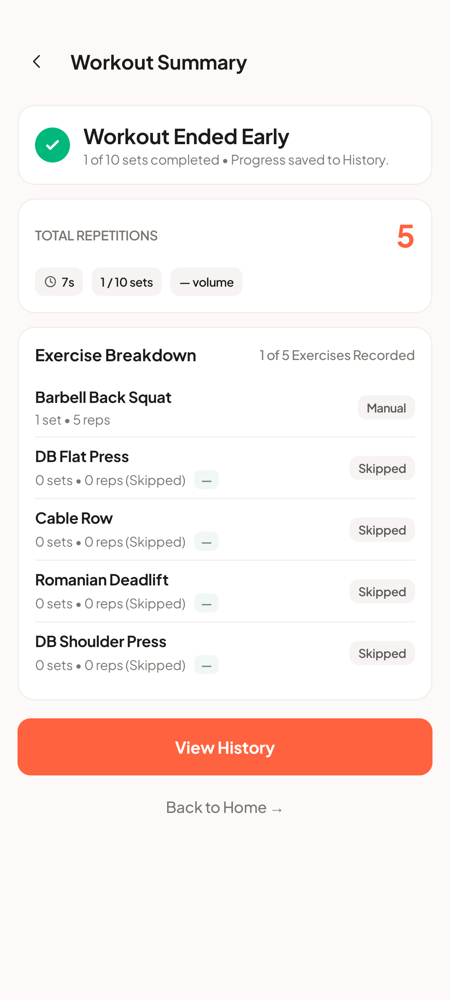 | 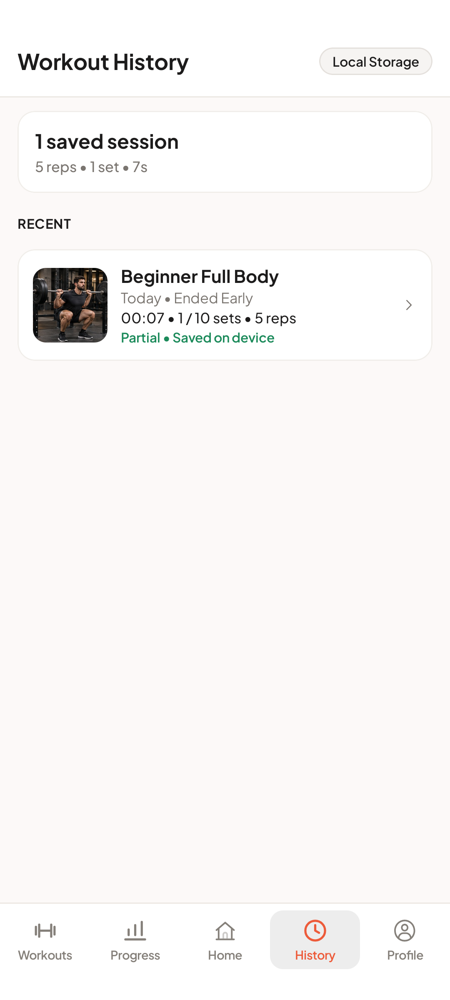 | 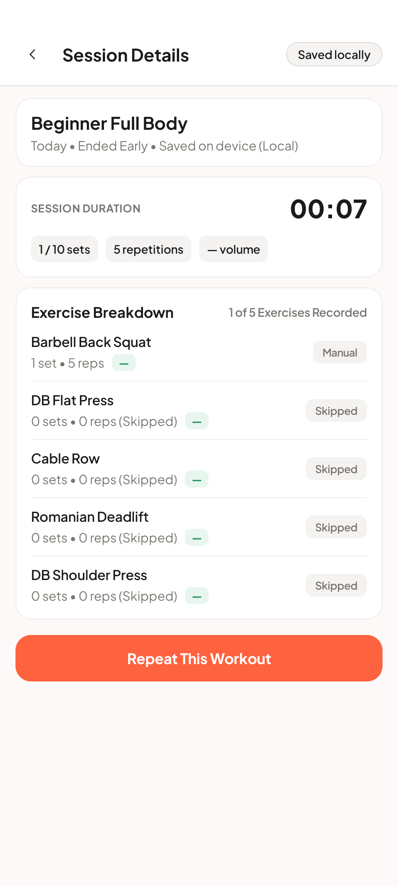 | 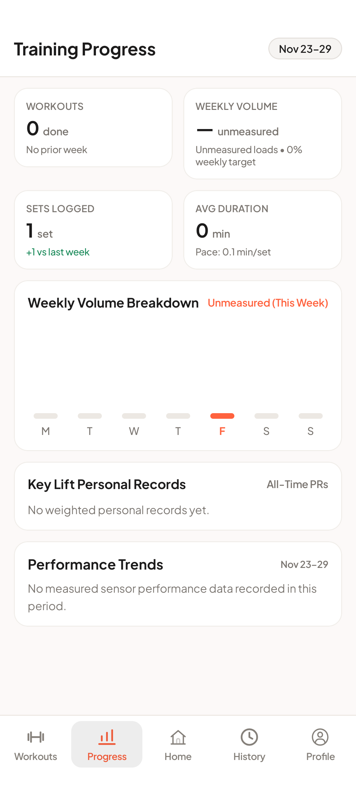 | 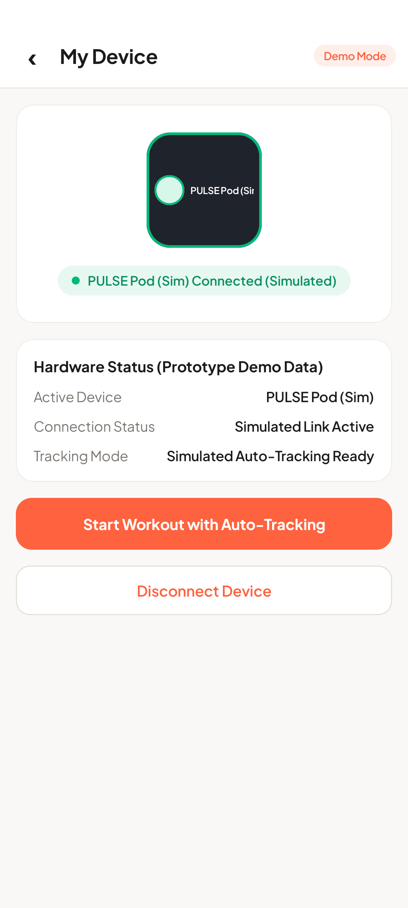 | 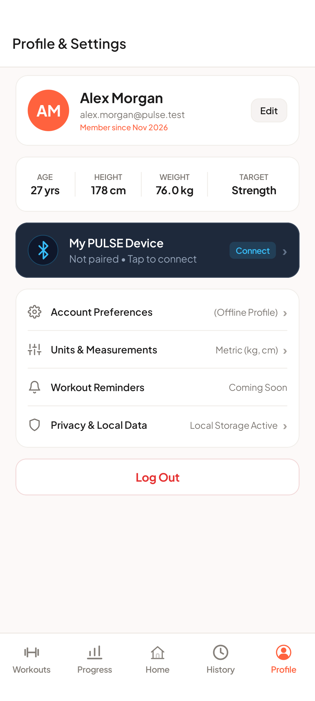 |

---

## 10. Figma Design Reference

- **Figma Project**: [PULSE — Smart Gym](https://www.figma.com/design/UvskyKTyxlIOd68wQkp5cQ/PULSE---Smart-Gym)

---

## 11. Installation, Build & Execution

### Prerequisites
- Android Studio (with JDK 17/21 JBR)
- Android SDK (`compileSdk = 37`, `targetSdk = 36`, `minSdk = 24`)

### Clone & Build
```bash
git clone https://github.com/AyaSheta13/PULSE-SmartGym.git
cd PULSE-SmartGym
./gradlew :app:assembleDebug :app:assembleRelease :app:bundleRelease
```

### Install Debug APK on Device / Emulator
```bash
adb install -r app/build/outputs/apk/debug/app-debug.apk
adb shell am start -n com.ayasheta.pulsesmartgym/.MainActivity
```

> Release APK (`app/build/outputs/apk/release/app-release-unsigned.apk`) and AAB (`app/build/outputs/bundle/release/app-release.aab`) are R8-minified and require signing with an authorized keystore before production distribution. See [docs/APP_INSTALLATION_GUIDE.md](docs/APP_INSTALLATION_GUIDE.md).

---

## 12. Testing Results

Run full verification suite:
```bash
./gradlew :core:model:build :core:data:testDebugUnitTest :core:designsystem:testDebugUnitTest :app:testDebugUnitTest :core:data:connectedDebugAndroidTest :app:connectedDebugAndroidTest :app:lintDebug :app:assembleDebug :app:assembleRelease :app:bundleRelease
```

| Suite | Tests | Failures | Errors | Skipped | Status |
| --- | :---: | :---: | :---: | :---: | :---: |
| `:core:model:build` (JVM unit) | 14 | 0 | 0 | 0 | **PASS** |
| `:core:data:testDebugUnitTest` (JVM unit) | 10 | 0 | 0 | 0 | **PASS** |
| `:core:designsystem:testDebugUnitTest` (JVM unit) | 4 | 0 | 0 | 0 | **PASS** |
| `:app:testDebugUnitTest` (JVM unit) | 73 | 0 | 0 | 0 | **PASS** |
| `:core:data:connectedDebugAndroidTest` (Room + Migrations) | 36 | 0 | 0 | 0 | **PASS** |
| `:app:connectedDebugAndroidTest` (Compose UI + Raw BLE E2E) | 69 | 0 | 0 | 0 | **PASS** |
| **Total** | **206** | **0** | **0** | **0** | **PASS** |

- **Android Lint (`:app:lintDebug`)**: **PASS** (`0` errors)

---

## 13. Current Project Status & Known Limitations

- **Android Application Readiness (Gate A)**: **READY**
- **Android Hardware Integration Readiness (Gate B)**: **READY** (transport, decoder, calibration gating, replay isolation, and raw-telemetry E2E tests verified)
- **Physical Hardware Validation (Gate C)**: **PENDING** (physical ESP32 + finalized UUIDs + live sensor calibration not yet tested)
- **Known Limitations**: See [docs/KNOWN_LIMITATIONS.md](docs/KNOWN_LIMITATIONS.md) (unsigned release artifacts pending keystore, local-only auth, per-rep summary waveform rather than 50 Hz raw IMU waveform, and physical ESP32 testing pending).
