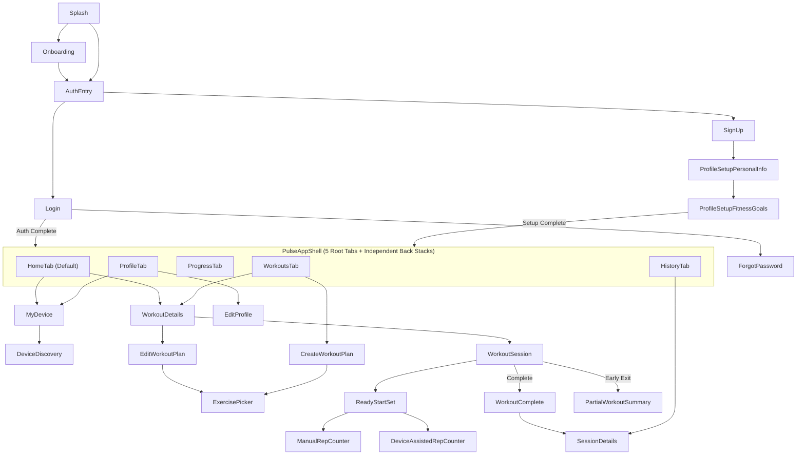

# PULSE Smart Gym — P2 Navigation 3 & Application Shell Report

**Phase:** P2 (Navigation 3 & Application Shell)  
**Date:** 2026-11-25  
**Status:** Complete — Ready for P3

---

## 1. Navigation 3 Version & Dependencies

- **AndroidX Navigation 3:** `1.2.2`
  - `androidx.navigation3:navigation3-runtime:1.2.2`
  - `androidx.navigation3:navigation3-ui:1.2.2`
- **Kotlin Serialization:** `1.9.0` (`org.jetbrains.kotlin.plugin.serialization` + `org.jetbrains.kotlinx:kotlinx-serialization-core:1.9.0`)
- No Navigation Compose 2 (`NavController` / `NavHost`) dependencies or APIs are used.

---

## 2. Navigation Architecture & Flow



---

## 3. Route Inventory (`NavKey` + `@Serializable`)

- **Auth & Onboarding (`AuthRoutes.kt`):** `Splash`, `Onboarding`, `AuthEntry`, `Login`, `SignUp`, `ForgotPassword`, `ProfileSetupPersonalInfo`, `ProfileSetupFitnessGoals`.
- **Main Root Tabs (`MainRoutes.kt`, `PulseRootRoute`):** `WorkoutsTab`, `ProgressTab`, `HomeTab`, `HistoryTab`, `ProfileTab` (mapped 1:1 to `PulseTab`).
- **Workout Planning (`WorkoutRoutes.kt`):** `WorkoutDetails(planId)`, `CreateWorkoutPlan`, `EditWorkoutPlan(planId)`, `ExercisePicker(planId?)`.
- **Workout Execution & Summaries (`SessionRoutes.kt`):** `WorkoutSession(planId, sessionId?)`, `ReadyStartSet(sessionId, exerciseId, setIndex)`, `ManualRepCounter(sessionId, exerciseId, setIndex)`, `DeviceAssistedRepCounter(sessionId, exerciseId, setIndex)`, `WorkoutComplete(sessionId)`, `PartialWorkoutSummary(sessionId)`, `SessionDetails(sessionId)`.
- **Device & Profile (`DeviceRoutes.kt`):** `MyDevice`, `DeviceDiscovery`, `EditProfile`.

All routes represent logical destinations; UI states (e.g., Workout Session states A–E, Device Connection states Searching/Connecting/Connected/Lost) remain UI state inside their respective destinations.

---

## 4. Multiple Back Stacks, Tab Switching & System Back Policy

- **Multiple Back Stacks (`PulseNavigationState.kt` & `PulseNavDisplay.kt`):**
  - `authBackStack` (`rememberNavBackStack(Splash)`) for pre-auth/onboarding.
  - Five independent `tabBackStacks` (`rememberNavBackStack(tab.toRootRoute())`) for `WORKOUTS`, `PROGRESS`, `HOME`, `HISTORY`, and `PROFILE`.
  - `activeFlow` (`AUTH` / `MAIN`) and `selectedTab` (`PulseTab`) are persisted directly via `rememberSaveable` `MutableState`s (no composition side effects).
  - Each stack is independently decorated via `rememberDecoratedNavEntries(backStack = ..., entryDecorators = listOf(rememberSaveableStateHolderNavEntryDecorator()), entryProvider = ...)` so each tab owns an isolated `SaveableStateHolder`.
  - `NavDisplay(entries = activeEntries, ...)` is wrapped in `key(navigationState.activeFlow, navigationState.selectedTab)` so identical destination keys (e.g., `WorkoutDetails("plan_sample_1")`) under different tabs never collide in `NavDisplay`.
- **Tab Selection (`PulseNavigator.selectTab`):**
  - Switching to another tab preserves the previous tab's nested stack and restores the target tab's top destination.
  - Re-selecting the already active tab while on a nested route pops back to that tab's root; re-selecting at root is a no-op (never duplicates roots).
- **System Back (`PulseNavigator.navigateBack` + `BackHandler`):**
  1. Modal overlays (`Dialog`) intercept System Back first and dismiss without popping the underlying route.
  2. In `AUTH` flow: pops `authBackStack` if `size > 1`; otherwise allows system exit.
  3. In `MAIN` flow: pops nested destination if `activeBackStack.size > 1`; else if `selectedTab != PulseTab.HOME`, switches to `PulseTab.HOME`; else at `HomeTab` root allows system exit.
- **Duplicate Prevention:** `PulseNavigator.navigate` ignores consecutive identical routes (`stack.lastOrNull() == route`).

---

## 5. Shell, Insets, Top App Bar, Theme Bridge & Overlays

- **Bottom Bar Visibility (`NavigationPolicy.shouldShowBottomBar`):** Visible **only** on the 5 `PulseRootRoute` destinations; hidden on Auth, Onboarding, Planning details, Live Session, Rep Counters, Summaries, Device, and Edit Profile.
- **Insets Ownership (`PulseAppShell.kt` & `ScreenSkeleton.kt`):**
  - `MainActivity` calls `enableEdgeToEdge()`.
  - `PulseAppShell` owns `WindowInsets.statusBars` at the root.
  - When the bottom bar is visible, `PulseBottomNavigationBar` owns `WindowInsets.navigationBars`.
  - When the bottom bar is hidden, `PulseAppShell` applies `WindowInsets.navigationBars` + `imePadding()` to the content container.
  - `ScreenSkeleton` exposes `applyStatusBarPadding: Boolean = true` so it never duplicates status-bar padding when nested inside `PulseAppShell`.
- **Top App Bar Height (`TopBar.kt`):** Refactored root container from `Column` (64dp + 1dp = 65dp) to `Box(height = 64.dp)` with the `1.dp` divider aligned at `Alignment.BottomCenter`, matching Figma `470:57` (64dp total).
- **Modal Overlays (`PulseBottomSheet.kt`, `PulseConfirmationDialog.kt`):** Wrapped in `androidx.compose.ui.window.Dialog` (`usePlatformDefaultWidth = false`, `decorFitsSystemWindows = false`) with `semantics { dialog() }`, scrim tap handling, System Back interception, `navigationBars` + `imePadding()`, and animated slide-down/scrim-fade exit transition on `PulseBottomSheet`.
- **Material 3 Bridge (`PulseApp.kt`):** `PulseMaterialThemeBridge` maps `PulseTheme.color` and `PulseTheme.typography` to `MaterialTheme` so Material 3 components inherit PULSE tokens without introducing a second token system.

---

## 6. Transitions & State Restoration

- **Transitions (`PulseNavigationTransitions.kt`):** Uses Navigation 3 `transitionSpec`, `popTransitionSpec`, and `predictivePopTransitionSpec` with subtle horizontal slide (`20%`) + fade (`220ms`/`200ms`). Respects `ValueAnimator.areAnimatorsEnabled()` (0ms when animations are disabled).
- **State Restoration:** `rememberNavBackStack` + `rememberSaveable` + `rememberSaveableStateHolderNavEntryDecorator()` preserve `activeFlow`, `selectedTab`, per-tab back stacks, and per-entry Compose `rememberSaveable` state across recomposition, configuration changes, and process death.

---

## 7. Verification Results

- **Gradle Build, Unit & Instrumentation Tests (`Medium_Phone_API_36.0(AVD) - 16`):**
  ```powershell
  .\gradlew.bat :core:designsystem:assembleDebug :core:designsystem:testDebugUnitTest :app:assembleDebug :app:testDebugUnitTest :app:connectedDebugAndroidTest --no-daemon
  ```
  - Result: **BUILD SUCCESSFUL in 1m 3s**
  - `:core:designsystem:testDebugUnitTest` (`PulseDesignSystemContractTest`): **PASSED**
  - `:app:testDebugUnitTest` (`ExampleUnitTest`, `PulseNavigatorTest` — 10 tests including `debugAuthBypass_isBlockedWhenDebugDisabledAndAllowedWhenEnabled`): **PASSED**
  - `:app:connectedDebugAndroidTest` on `Medium_Phone_API_36.0(AVD) - 16` (6/6 tests): **PASSED**
    - `PulseNavigationUiTest.tabSwitching_preservesSaveableStateAcrossRootTabs` — **PASSED**
    - `PulseNavigationUiTest.sameDestinationUnderDifferentTabs_preservesIndependentSaveableState` — **PASSED**
    - `PulseNavigationUiTest.releaseMode_hidesDebugAuthBypassAcrossAuthFlow` — **PASSED**
    - `PulseNavigationUiTest.modalSheet_dismissesWithSystemBackWithoutPoppingUnderlyingRoute` — **PASSED**
    - `PulseActivityRecreationUiTest.activityRecreation_preservesSelectedTabAndSaveableState` — **PASSED**
    - `ExampleInstrumentedTest.useAppContext` — **PASSED**
  - Process-death (`am kill` restore): **NOT TESTED** (activity recreation via `ActivityScenario.recreate()` was tested and passed).

---

## 8. Debug Launch Policy & Deferred Work

- `MainActivity` passes `isDebugEntryEnabled = (applicationInfo.flags and ApplicationInfo.FLAG_DEBUGGABLE) != 0`.
- All temporary auth-to-main bypass actions (`Splash`, `AuthEntry`, `Login`, `ProfileSetupFitnessGoals`) are guarded by `isDebugEntryEnabled` both in UI visibility and inside `PulseNavigator.completeDebugAuthBypass(isDebugEntryEnabled)` (hard no-op when `false`).
- Room, DataStore, `FakeAuthRepository`, BLE, and real feature screens remain deferred to P3+.
