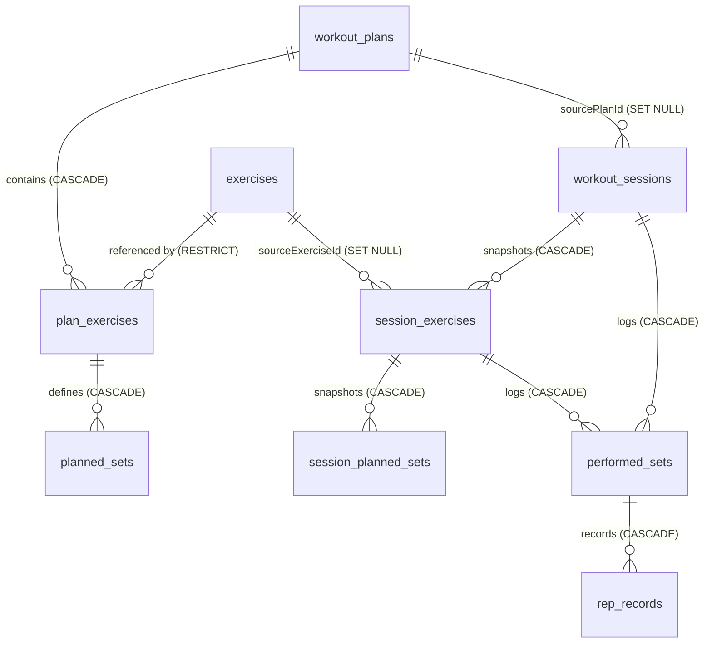

# PULSE Smart Gym — P3 Database Schema

**Database Class:** `com.ayasheta.pulsesmartgym.core.data.local.database.PulseDatabase`  
**Schema Version:** `1` (`exportSchema = true`)  
**Exported Schema JSON:** `core/data/schemas/com.ayasheta.pulsesmartgym.core.data.local.database.PulseDatabase/1.json`

---

## 1. Entity-Relationship Diagram

---

## 2. Tables, Keys, Indexes & Foreign-Key Policies

| Table | Primary Key | Unique Indexes | Foreign Keys & Delete Policy | Purpose |
|---|---|---|---|---|
| `exercises` | `id` | — | — | Exercise catalog (`LINEAR`, `ANGULAR`, `COMPOUND`). |
| `workout_plans` | `id` | — | — | Reusable workout plan templates. |
| `plan_exercises` | `id` | — | `planId` → `workout_plans.id` (`CASCADE`), `exerciseId` → `exercises.id` (`RESTRICT`) | Ordered exercise occurrences inside a plan (supports duplicate exercise definitions). |
| `planned_sets` | `id` | `(planExerciseId, setIndex)` | `planExerciseId` → `plan_exercises.id` (`CASCADE`) | 1-based target sets (`targetReps`, optional `targetLoadGrams`, `targetRestSeconds`). |
| `workout_sessions` | `id` | — | `sourcePlanId` → `workout_plans.id` (`SET NULL`) | Active or historical workout execution; `planNameSnapshot` preserves name if plan is edited/deleted. |
| `session_exercises` | `id` | — | `sessionId` → `workout_sessions.id` (`CASCADE`), `sourceExerciseId` → `exercises.id` (`SET NULL`) | Immutable snapshot of exercise name, muscle, equipment, tracking category, and order at session start. |
| `session_planned_sets` | `id` | `(sessionExerciseId, setIndex)` | `sessionExerciseId` → `session_exercises.id` (`CASCADE`) | Immutable snapshot of planned set targets at session start. |
| `performed_sets` | `id` | `(sessionId, sessionExerciseId, setIndex)` | `sessionId` → `workout_sessions.id` (`CASCADE`), `sessionExerciseId` → `session_exercises.id` (`CASCADE`) | Actual logged sets (`fullReps`, `partialReps`, nullable `actualLoadGrams`, `trackingMode`, `origin`). |
| `rep_records` | `id` | `(performedSetId, repIndex)` | `performedSetId` → `performed_sets.id` (`CASCADE`) | Extensible per-rep telemetry (`FULL`/`PARTIAL`, durations in ms, `angularRomDegrees`, `linearRomCm`). |

---

## 3. Data Integrity & Unit Policies

- **Duplicate Set Protection:** `performed_sets` enforces a unique SQLite index on `(sessionId, sessionExerciseId, setIndex)`. `WorkoutSessionDao.insertPerformedSetIgnore` uses `OnConflictStrategy.IGNORE` and returns `-1L` on conflict, mapped to `RecordSetResult.AlreadyRecorded`. `OnConflictStrategy.REPLACE` is never used for performed sets.
- **Owner Isolation & Conditional Status Updates:** All `WorkoutPlanDao` and `WorkoutSessionDao` queries and mutations filter by `ownerProfileId = :ownerId`. Terminal transitions use `updateSessionStatusIfActive` (`WHERE id = :sessionId AND ownerProfileId = :ownerId AND status = 'ACTIVE'`), ensuring sets cannot be recorded after a session becomes terminal and concurrent terminal transitions cannot overwrite each other.
- **Explicit Corrections:** `correctPerformedSet` uses `@Update` + `replace` of rep records on the existing row inside a single transaction rather than disguised inserts.
- **1-Based `setIndex`:** All planned and performed sets use 1-based `setIndex` (`>= 1`), validated by `PulseValidators`.
- **Canonical Units:**
  - Load is stored as `Long` grams (`actualLoadGrams`, `targetLoadGrams`); `null` represents unknown/bodyweight load and is never converted to `0`.
  - Instants are stored as UTC epoch milliseconds (`Long`).
  - Durations are stored in milliseconds (`Long`).
  - Angular ROM (`angularRomDegrees: Double?`) and linear ROM (`linearRomCm: Double?`) are separate typed columns.
- **Session Status Rules:**
  - `ACTIVE`: Session in progress.
  - `COMPLETED`: All `session_planned_sets` have matching `performed_sets`.
  - `PARTIALLY_COMPLETED`: Ended early via `endSessionEarly` with `>= 1` `performed_sets`.
  - `ABANDONED`: Ended early with `0` `performed_sets`.
- **Migration Strategy:** `PulseDatabase` starts at `version = 1` with `exportSchema = true` and **no** `fallbackToDestructiveMigration()`. Future schema changes will use explicit Room `Migration` objects.
